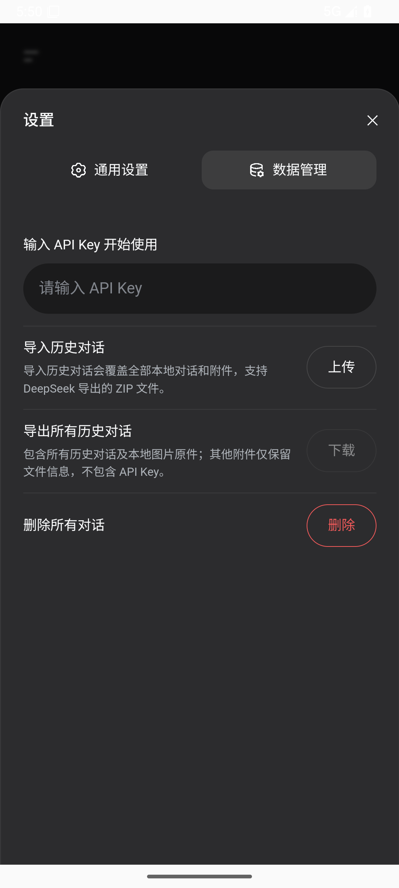
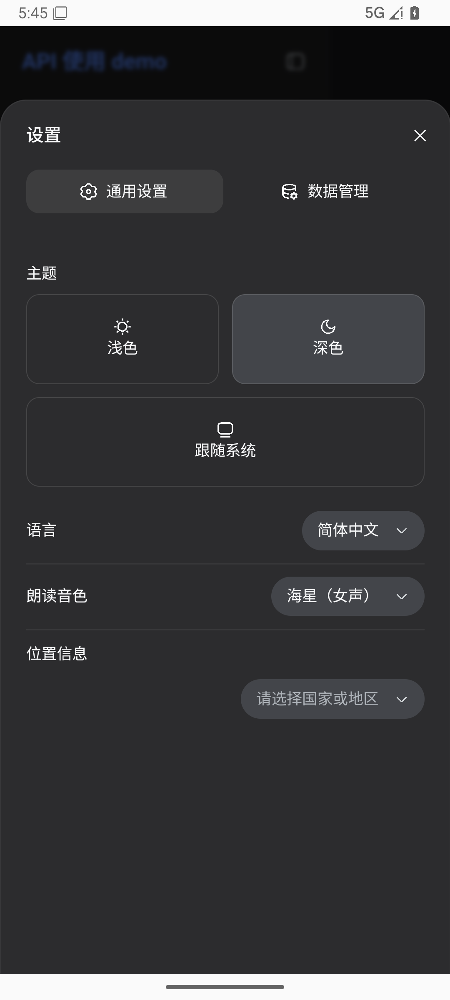

# DeepSeek APP Replica

把 DeepSeek 官方 App 的对话体验搬到安卓上，用**自己的 API Key** 跑，不受官方免费额度的各种限制。

界面不是仿的，是**官方自己开源的**前端 —— 来自 [deepseek-ai/chat-demo](https://github.com/deepseek-ai/chat-demo)（MIT 许可，2026-11-12 随「全家桶应用 API」一起发布）。外面套一层 [Capacitor 8](https://capacitorjs.com/) 安卓壳。

---

## 它是什么，不是什么

**是**：一个能装在安卓手机上的独立 App。填自己的 API Key 后，深度思考、联网搜索、文件上传、语音输入、多会话这些都有。

**不是**：不是官方 App 的破解版，不提供免费额度。模型调用走你自己的 DeepSeek API 账户，按 token 计费。

### 与官方 App 的差异

| | 官方 App | 本项目 |
|---|---|---|
| 计费 | 官方出算力，免费 | 扣你自己的 API 余额 |
| 单次输入长度 | 约 4 万字 | 受模型上下文限制（1M tokens） |
| 会话保存 | 官方服务器，7 天不活跃会清 | 手机本地，不会被清 |
| 每日额度 | 有 | 无，只有余额 |
| 跨设备同步 | 有 | 无 |
| 账号体系 | 有 | 无 |

**换句话说**：用「每月几十块的账单」换「把限制去掉 + 数据留在自己手机里」。

---

## 功能

- 流式回复、深度思考过程展开
- 联网搜索 + 来源引用、链接自动阅读
- 图片 / PDF / Office 附件上传与解析
- 语音输入、回复朗读
- Markdown、代码高亮、KaTeX 公式、Mermaid 图表
- 多会话管理（自动标题、重命名、删除、消息分支切换）
- 深浅色主题、中英文切换
- 导入 DeepSeek 官方 App 导出的历史对话（ZIP）
- 导出全部对话为 ZIP（安卓端走「写文件 + 系统分享」）

## 截图

| 主界面 | 设置（深色） | 主题与语言 |
|---|---|---|
|  |  |  |

---

## 安装

`release/` 目录下有已构建好的 debug APK：

```
release/DeepSeek-APP-Replica-debug.apk
```

传到手机安装即可。要求 Android 8.0+，系统 WebView 建议 Chrome 105+。

**第一次打开会要求填 API Key**（在 <https://platform.deepseek.com/api_keys> 创建）。

---

## 从源码构建

### 环境要求

- Node.js 22.12+
- pnpm
- JDK 21
- Android SDK（compileSdk 36、build-tools 36.0.0）

设好环境变量：

```powershell
$env:JAVA_HOME  = "<你的 JDK 21 路径>"
$env:ANDROID_HOME = "<你的 Android SDK 路径>"
$env:ANDROID_SDK_ROOT = $env:ANDROID_HOME
```

`android/local.properties` 写上 `sdk.dir=<SDK 路径>`（该文件已被 gitignore）。

### 构建

```powershell
pnpm install
pnpm build                    # 构建网页产物到 dist/
pnpm exec cap sync android    # 同步到安卓工程
cd android
.\gradlew.bat assembleDebug   # 产物：app/build/outputs/apk/debug/app-debug.apk
```

---

## 相对官方 chat-demo 的改动

上游是纯网页 demo，本项目只做了「让它成为一个能装的安卓 App」所需的最小改动。

### 新增

| 文件 | 作用 |
|---|---|
| `src/services/native/platform.ts` | 判断是否在原生壳内；导出 ZIP 在安卓端改用 Filesystem + Share |
| `src/app/useNativeShell.ts` | 接管安卓返回键（关弹层 → 回列表 → 退 App），状态栏图标跟随主题 |
| `scripts/build.mjs` | 跨平台构建脚本（官方的是 `rm -rf`，Windows 上不可用） |
| `capacitor.config.ts` | Capacitor 配置 |

### 修改

| 文件 | 改动 |
|---|---|
| `src/index.html` | viewport 加 `viewport-fit=cover` |
| `src/app/App.module.css` | 根容器加 `box-sizing` 与安全区 padding |
| `src/app/App.tsx` | 挂载 `useNativeShell` |
| `src/components/settings/SettingsDialog.tsx` | 导出逻辑分流到原生实现 |
| `android/app/src/main/AndroidManifest.xml` | 加 `RECORD_AUDIO` 权限 |
| `android/build.gradle` | Maven 换阿里云镜像（国内直连 Central 会失败） |
| `android/gradle.properties` | 允许含非 ASCII 字符的项目路径 |

### 工具

`tools/` 下有开发期自测脚本：

| 脚本 | 用途 |
|---|---|
| `serve.mjs` | 本地静态服务器，用来在浏览器里验证 dist |
| `shot.mjs` | 用 Chrome DevTools 协议做精确设备尺寸截图 |
| `webview-eval.mjs` | 通过 adb 连到真机/模拟器里的 WebView 执行 JS，用于自动化断言 |

---

## 已知问题

| 问题 | 说明 |
|---|---|
| 启动图 / 桌面图标是 Capacitor 默认素材 | 未替换 |
| 状态栏底色跟随系统而非 App 主题 | WebView 内核 < 140 时做不到真全屏；内核 ≥ 140 的设备会自动正确 |
| 键盘弹出后的布局未经真机验证 | — |
| 语音输入未经真机验证 | 权限已声明，模拟器无麦克风 |
| 这是 debug 构建 | debug 包默认开放 WebView 调试口，正式分发请打 release 并自备 keystore |

---

## 隐私与安全

- **API Key 只存在本机**（WebView 的 localStorage，属于 App 私有目录，其他 App 读不到）。
- **对话数据不上传到任何第三方服务器**，只在你发消息时提交给 DeepSeek API 本身。
- **卸载 App 会清空全部本地对话**，重要内容请先在设置里导出 ZIP。
- 不要把自己填了 Key 的设备交给别人；不要在 root 过的设备上使用。
- 若要分发给他人：**让每个人填自己的 Key**，绝不要把 Key 打包进 APK，也不要自建后端替所有人转发。

## 许可

界面与主要代码来自 [deepseek-ai/chat-demo](https://github.com/deepseek-ai/chat-demo)，MIT 许可，见 `LICENSE`。

「DeepSeek」名称与标识归其所有者所有。本仓库是个人项目，与 DeepSeek 官方无关。若要公开发布，请更换应用名称与图标。
